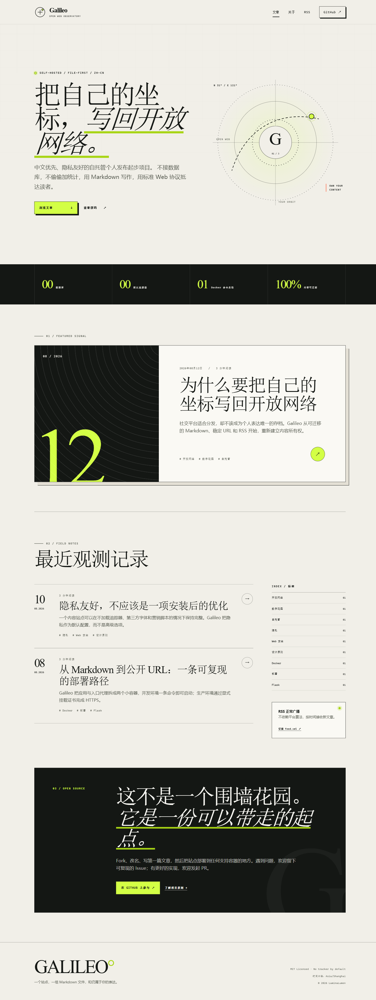

<div align="center">

# Galileo

### 把自己的坐标，写回开放网络。

中文优先、隐私友好的自托管个人发布起步项目。

[](https://github.com/LaminaLumen/Galileo/actions/workflows/ci.yml)
[](LICENSE)
[](pyproject.toml)

[快速开始](#快速开始) · [写作](#写一篇文章) · [部署](docs/DEPLOYMENT.md) · [贡献](CONTRIBUTING.md) · [路线图](ROADMAP.md)

</div>

> [!IMPORTANT]
> Galileo 目前处于 `0.x` Alpha 阶段，接口和内容格式可能在发布说明中明确变更。它已经适合试用和二次开发，但不宣称已被广泛采用。



## 为什么是 Galileo

社交平台擅长分发，却不应成为个人表达唯一的存档。Galileo 提供一条小而清楚的自托管路径：文章保存在可迁移的 Markdown 文件中，由 Flask 渲染为语义化页面，同时通过 RSS、sitemap 和稳定 URL 对开放网络广播。

- **文件优先**：无数据库、无专有导出格式，内容可直接被 Git 版本化。
- **隐私默认**：不加载第三方字体、分析脚本、追踪像素或外部图片。
- **中文优先**：排版、示例、文档与默认时区面向中文写作者设计。
- **开放协议**：内置 RSS 2.0、sitemap.xml、robots.txt 和 canonical URL。
- **安全边界清楚**：原始 HTML 默认禁用，内置 CSP 等安全响应头，证书只允许运行时挂载。
- **容易自托管**：本地 Python 零构建预览，Docker Compose 一条命令启动。

## 功能

| 能力 | 当前实现 |
| --- | --- |
| 内容来源 | `content/posts/*.md`，带轻量 front matter |
| 页面 | 首页、文章详情、标签筛选、关于页、404 |
| 订阅与发现 | RSS 2.0、sitemap.xml、robots.txt |
| 运行方式 | Flask 应用工厂、Gunicorn、Nginx、Docker Compose |
| 安全 | Markdown 原始 HTML 隔离、CSP、非 root 容器、只读文件系统 |
| 质量 | pytest、Ruff、跨 Python 版本 GitHub Actions、依赖更新 |
| 时区 | 显式使用 IANA `Asia/Shanghai`，文章时间必须带偏移 |

## 快速开始

### Docker Compose（推荐）

前置条件：Docker Desktop 或 Docker Engine 24+，并支持 Compose v2。

```powershell
git clone https://github.com/LaminaLumen/Galileo.git
Set-Location Galileo
Copy-Item .env.example .env
docker compose up --build
```

打开 [http://localhost:8080](http://localhost:8080)。默认只绑定 `127.0.0.1`，不会直接暴露到局域网或公网。

停止并清理容器：

```powershell
docker compose down
```

### 本地 Python

前置条件：Python 3.11 或更高版本。

```powershell
python -m venv .venv
.\.venv\Scripts\Activate.ps1
python -m pip install -r requirements-dev.txt
python app.py
```

打开 [http://127.0.0.1:5000](http://127.0.0.1:5000)。内容文件会在每次请求时重新读取，修改后刷新即可预览。

## 写一篇文章

在 `content/posts/` 新建只含小写字母、数字和连字符的 Markdown 文件，例如 `my-first-note.md`：

```markdown
---
title: "我的第一篇观测记录"
summary: "用于首页和搜索摘要的一句话说明。"
date: "2026-08-12T09:00:00+08:00"
tags: ["随笔", "开放网络"]
featured: false
draft: false
---

从这里开始写正文。
```

字段说明：

| 字段 | 必填 | 说明 |
| --- | --- | --- |
| `title` | 是 | 最多 120 个字符 |
| `summary` | 是 | 最多 240 个字符 |
| `date` | 是 | ISO 8601，必须带时区偏移；默认展示为北京时间 |
| `tags` | 否 | JSON 数组或逗号分隔，最多 8 个 |
| `featured` | 否 | 设为 `true` 可作为首页重点文章 |
| `draft` | 否 | 草稿默认不出现在页面、RSS 和 sitemap |

生产环境不要设置 `SHOW_DRAFTS=1`。Markdown 中的原始 HTML 默认会被转义，这是安全边界的一部分。

## 配置

复制 `.env.example` 为 `.env` 后可修改：

| 环境变量 | 默认值 | 用途 |
| --- | --- | --- |
| `SITE_NAME` | `Galileo` | 站点名称 |
| `SITE_TAGLINE` | `把自己的坐标，写回开放网络` | 站点标语 |
| `SITE_DESCRIPTION` | 项目默认说明 | SEO 与页面介绍 |
| `SITE_AUTHOR` | `LaminaLumen` | 页面与 RSS 作者标识 |
| `SITE_URL` | `http://localhost:8080` | canonical、RSS 与 sitemap 的公开根地址 |
| `TZ` | `Asia/Shanghai` | IANA 时区名称 |
| `GALILEO_BIND_ADDRESS` | `127.0.0.1` | 容器入口绑定地址 |
| `GALILEO_PORT` | `8080` | 容器入口端口 |

完整的生产部署、TLS、反向代理和升级步骤见 [部署指南](docs/DEPLOYMENT.md)。

## 开发与验证

```powershell
python -m pip install -r requirements-dev.txt
ruff check .
ruff format --check .
pytest
```

验证容器配置：

```powershell
docker compose config --quiet
docker compose build
docker compose up --wait
Invoke-RestMethod http://localhost:8080/healthz
docker compose down
```

架构、信任边界和设计选择见 [架构说明](docs/ARCHITECTURE.md)。

## 项目状态与参与方式

Galileo 由主要维护者负责方向、评审和发布，采用轻量治理模式。当前最需要的是真实自托管反馈、可访问性测试、部署环境兼容性报告和小而完整的改进。

- 提交问题前阅读 [贡献指南](CONTRIBUTING.md)；
- 安全问题不要公开创建 Issue，请遵循 [安全政策](SECURITY.md)；
- 版本规划见 [路线图](ROADMAP.md)；
- 版本变化见 [变更记录](CHANGELOG.md)；
- 维护职责与决策方式见 [治理说明](GOVERNANCE.md)。

## 许可证

Galileo 采用 [MIT License](LICENSE)。你可以使用、修改和分发，但请保留许可证与版权声明。
