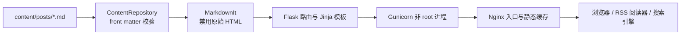

# Galileo 架构说明

本文描述项目通用架构、数据流和信任边界。具体安装命令见 [部署指南](DEPLOYMENT.md)。

## 设计目标

Galileo 面向希望拥有个人内容控制权、同时不想维护完整 CMS 的中文写作者与开发者。架构优先级依次为：

1. 原始内容长期可读、可迁移；
2. 默认数据流最小且容易解释；
3. 单人维护者可以完整理解和测试；
4. 使用标准协议与普通容器环境；
5. 在真实需求出现前不引入数据库、队列或外部服务。

## 组件

### 内容层

- 文件名即公开 slug；
- front matter 保存标题、摘要、带时区发布时间、标签和草稿状态；
- 每次请求重新读取内容，保持本地预览无构建步骤；
- 草稿默认不会进入网页列表、RSS 或 sitemap。

### 应用层

- Flask 应用工厂使测试和嵌入式配置可控；
- Markdown 采用 CommonMark，原始 HTML 关闭；
- Jinja 默认自动转义元数据，只有 Markdown 渲染结果在经过安全边界后标记为 HTML；
- RSS 与 sitemap 使用标准库生成 XML，不拼接未转义字符串；
- 健康检查使用明确的 `Asia/Shanghai` 带时区时间。

### 入口层

- Gunicorn 只在 Compose 内部网络暴露 8000；
- Nginx 默认从宿主机 `127.0.0.1:8080` 进入；
- 两个容器均显式使用 `Asia/Shanghai`，日志时间不依赖基础镜像默认值；
- 静态资源由只读挂载直接提供；
- 应用和入口容器均使用只读根文件系统及 `no-new-privileges`；
- 生产 TLS 优先交给已有入口网关，或显式挂载仓库外证书。

## 主要数据流

### 页面请求

1. 客户端请求 Nginx；
2. `/static/` 从只读目录返回，其余请求转发到 Gunicorn；
3. Flask 从内容目录加载和校验 Markdown；
4. Markdown 转换为 HTML，模板补充站点导航与元数据；
5. 应用添加 CSP 等安全头，经 Nginx 返回。

### 内容发布

1. 维护者创建或修改 Markdown；
2. 测试校验格式、时区和路由；
3. Git 记录内容变化；
4. 部署平台拉取已审核版本并重建/重启应用；
5. 页面、RSS 和 sitemap 同时反映新内容。

## 信任边界与威胁

| 边界 | 默认控制 | 剩余责任 |
| --- | --- | --- |
| Markdown 内容 → HTML | 禁用原始 HTML；Jinja 自动转义元数据 | 维护者仍应评审外部链接和内容来源 |
| 浏览器 → 应用 | CSP、Frame 拒绝、权限策略、请求大小限制 | 生产入口需配置 TLS、速率限制和日志治理 |
| 容器 → 主机 | 非 root、只读、no-new-privileges、最小端口 | 主机补丁、Docker 权限和网络防火墙由部署者负责 |
| 仓库 → 运行时秘密 | `.gitignore`/`.dockerignore`；运行时只读挂载 | 秘密管理、轮换、撤销和访问控制由部署者负责 |
| 时间 → 外部协议 | 内部及用户展示为 `Asia/Shanghai`；RSS 显式携带偏移 | 与强制 UTC 的外部系统集成时需边界转换 |

## 扩展原则

新增数据库、评论、搜索、统计或第三方资源前，需要在 Issue 中回答：

- 真实用户问题是什么；
- 数据写到哪里、保存多久、如何导出和删除；
- 没有该服务时核心阅读功能是否仍可用；
- 维护者新增了哪些升级和安全责任；
- 是否有依赖更少的替代方案。

如果一项扩展让内容难以迁移或让默认数据流变得不可解释，它通常不适合进入核心。
